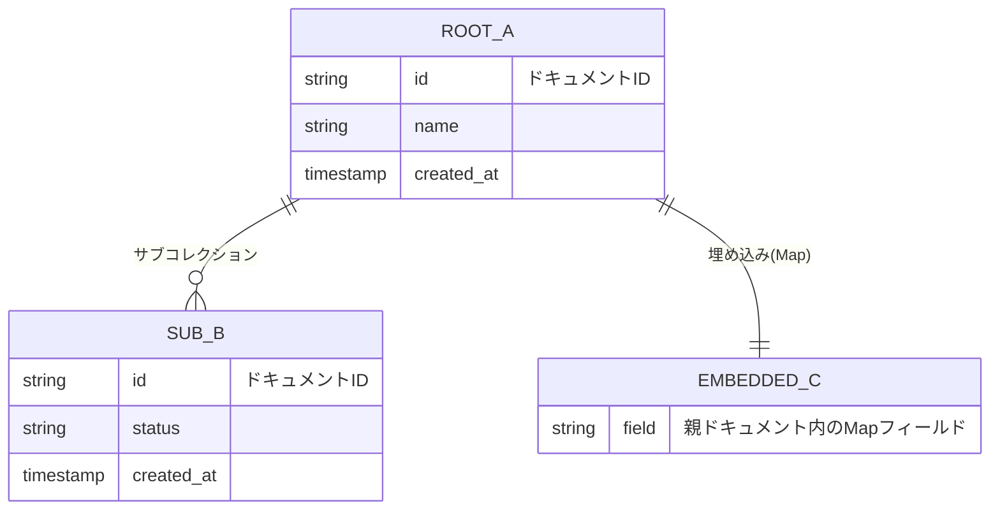

# データ構造設計（詳細設計）: {プロジェクト・機能名}

> Vモデル: 詳細設計 / 対応する検証: 単体テスト
> 機能（②）・画面（③）が扱うデータを、{Firestore / MongoDB / DynamoDB} のコレクション構成に落とし込む。

> **前提**: {DBの種類}。{既存のパス構成があるなら、踏襲する範囲と移行する範囲}。
> RDBのようなJOINが無いため、**画面が1回で読む単位でドキュメントを設計する**（4章・5章）。

## 1. コレクション一覧

| パス | 目的 | 関連機能(②) |
| ---- | ---- | ----------- |
| `{root}/{docId}` | {何のために持つか。1〜2文} | FUNC-01, FUNC-02 |
| `{root}/{docId}/{sub}/{subId}` | {サブコレクションにした理由が分かる書き方で} | FUNC-03 |

> パスの命名規則: {`festival/27/events` のように可変部が何を指すか}。
> 可変部（`{docId}`）が何から来るか（自動ID / 業務ID / 外部システムのID）を明記する。

## 2. データモデル関連図

RDBのリレーションではなく、**ドキュメントの入れ子（サブコレクション・埋め込み）**を示す。
`||--o{` は「配下にサブコレクションを持つ」または「配列で埋め込む」の意味で使う。

## 3. ドキュメント定義

### `{root}/{docId}`

**目的**: {このドキュメントが何のために存在するか。どの機能・画面を支えるか。1〜2文}

| フィールド | 型 | 必須・既定 | 説明 |
| ---------- | -- | ---------- | ---- |
| {field} | string | 必須 | {何が入るか。なぜ必要か} |
| {field} | string | 任意（既定なし） | {無いことがあり得る理由} |
| status | string | 必須, 既定 `{値}` | ステータス（`{値1}`={意味} / `{値2}`={意味}）。**未知の値は `{既定}` にフォールバックする** |
| {field} | map | 任意 | {埋め込みMap。中身は下の小見出しで定義する} |
| {field} | `array<string>` | 必須（0件可） | {配列にした理由と、想定される最大件数} |
| created_at | timestamp | 必須 | 作成日時（サーバ時刻） |
| updated_at | timestamp | 必須 | 更新日時（サーバ時刻） |

> ドキュメントIDの決め方: {自動ID / 業務キーをそのまま使う}。{そう決めた理由}

#### `{field}`（埋め込みMap）

**目的**: {独立したコレクションにせず親に埋めた理由}

| キー | 型 | 必須・既定 | 説明 |
| ---- | -- | ---------- | ---- |
| {key} | string | 必須 | {} |

### `{root}/{docId}/{sub}/{subId}`（サブコレクション）

**目的**: {親に埋め込まずサブコレクションに切った理由（件数が伸びる／個別に更新する／個別に権限を分ける）}

| フィールド | 型 | 必須・既定 | 説明 |
| ---------- | -- | ---------- | ---- |
| {field} | string | 必須 | {} |
| created_at | timestamp | 必須 | 作成日時 |

## 4. インデックス・クエリ方針

画面（③）が実行するクエリを列挙し、それぞれに必要なインデックスを対応させる。

| 画面・機能 | クエリ（絞り込み・並び順） | 必要なインデックス |
| ---------- | -------------------------- | ------------------ |
| SCR-01 / FUNC-01 | `where {field} == x` + `orderBy {field} desc` | 複合インデックス（{field}, {field} desc） |
| {} | {} | 単一フィールド（自動作成の範囲） |

> 単一フィールドのインデックスは自動作成される。**等価条件と並び順を組み合わせるクエリは
> 複合インデックスが必要**なので、上表に挙げたものを `firestore.indexes.json` へ定義する。

**クエリ制約から来る構造上の制限**:

- {`array-contains` は1クエリ1つまで、といった制約に対して構造をどう合わせたか}
- {全文検索が必要な箇所があるなら、DBでは解けないことと代替（前方一致用の正規化フィールド等）}

**セキュリティルールとの対応**: {誰がどのパスを読み書きできるか。
パス設計がその境界（ユーザー単位・テナント単位）と一致していること}

## 5. 非正規化・整合性の方針

- **非正規化した項目**: {どのドキュメントに何を複製したか}。
  理由: {1画面1回の読み取りで済ませるため／JOINが無いため}
- **同期をどこで担保するか**: {書込時に同一トランザクション（バッチ）でまとめて書く／
  Cloud Functions等で追随させる／画面側で再取得する}。**ずれた場合に何が起きるか**も書く。
- **ドキュメントサイズと配列の上限**: {伸び続ける配列がある場合、上限と、
  超えたときサブコレクションへ移す判断}
- **削除**: {物理削除か論理削除か。サブコレクションは親を消しても残るため、その扱い}

---

> 実際のスキーマ適用（`firestore.rules` / `firestore.indexes.json` / モデルクラス）は
> Build フェーズの成果物。この設計書ではコレクション構成・フィールド定義・制約までを正とする。

## 次のステップ

→ `05-api-ipo`（API・IPO一覧・詳細設計）でフローごとのIPOとデータアクセスの一覧を作成する
→ 必要に応じて `02-requirement`（要件定義書）の「対応データ」欄を追記更新する
