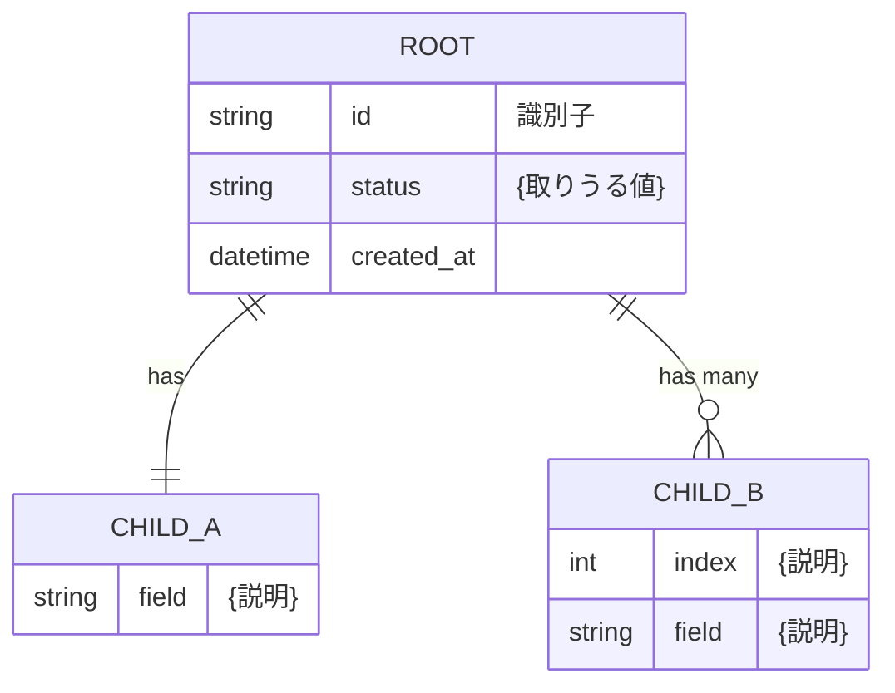

# データ構造・ファイルレイアウト設計（詳細設計）: {プロジェクト・機能名}

> Vモデル: 詳細設計 / 対応する検証: 単体テスト
> 機能（②）・画面（③）が扱うデータを、実装の土台となる構造に落とし込む。
>
> **本プロジェクトは永続化DBを持たない**（{根拠となる02の記述。例: 要件② Out of Scope
> 「DBによる永続化・履歴管理」}）。{なぜ不要かの説明。RDBの必要条件（同時書込・横断検索・
> JOIN・実行をまたぐ履歴）がいずれも発生しないことを、要件から示す}。
> よって本書は **RDBのテーブル設計ではなく、「構造化データモデル＋ファイルレイアウト」の設計** とする。
> 将来「{必要になりうる機能}」が要件化された場合の逃げ道は {SQLite等}。

## 1. データストア一覧

DBテーブルの代わりに、以下のデータストア（ファイル／構造）を扱う。

| データストア | 実体 | 目的 | 関連機能(②) |
| ------------ | ---- | ---- | ----------- |
| {名前} | {入力フォルダ内のファイル（読取専用）} | {何のために扱うか} | FUNC-01 |
| {名前} | `{work/...}` | {中間状態。何を保持するか} | FUNC-02, FUNC-03 |
| {名前} | `{output/...}` | {最終成果物} | FUNC-05 |
| {名前} | `{logs/...}` | {記録} | FUNC-01, FUNC-02 |

> `{id}` は {何に由来する識別子か}。{どの受入基準を支えるか}。

## 2. データモデル関連図

{中心となる構造}を頂点とする**構造（コンポジション）**を示す。
RDBのリレーションではなく、1つの{JSON}に入れ子で保持する。



## 3. データ構造定義

> **キー言語ポリシー**: 実装（モデル・中間ファイル）は **{英語}キー** を用いる。
> **利用者に渡る最終成果物の見出しは{日本語}ラベル** で出力する。
> 対応は各構造の「日本語ラベル（出力見出し）」列で定義し、出力生成時にこのラベルへ写像する。

### {Root}（{1件分の何か}）

**目的**: {この構造が何のために存在するか。どの機能の入力・出力になるか。1〜2文}

| フィールド | 型 | 制約 | 説明 |
| ---------- | -- | ---- | ---- |
| id | str | 必須, ユニーク | {何に由来するか。どこで使うか} |
| status | Literal["{値1}","{値2}"] | 必須 | {各値の意味} |
| {field} | {Child} | 必須 | {} |
| {field} | list[{Child}] | 必須（0件可） | {0件のとき何が起きるか} |
| created_at | datetime | 必須 | {} |

### {Child}（{単位}）

**目的**: {}

| フィールド（{英語}キー） | 日本語ラベル（出力見出し） | 型 | 制約 | 説明 |
| ------------------------ | -------------------------- | -- | ---- | ---- |
| {field} | {ラベル} | str | 必須 | {} |
| {field} | {ラベル} | str \| null | 任意 | {nullを許す理由} |

> 「必須」はキーが存在することを指す。値そのものは `null` を許容する（該当する場合）。

### {成果物}のレイアウト（FUNC-0x / {生成処理}）

**目的**: 最終成果物 `{output/...}` の{列構成・書式}を確定させる。

| ブロック | 内容 |
| -------- | ---- |
| {ヘッダ} | {} |
| {明細} | {1行目=見出し、2行目以降=…} |

```
{列1} | {列2} | {列3}
 ...  |  ...  |  ...
```

- {レイアウト上のルール。空欄の扱い・0件のときの出力・型}

### 列挙値の表示ラベル対応（実装値 → 表示）

| 実装値 | 表示 | 意味 |
| ------ | ---- | ---- |
| {value} | {表示} | {} |

## 4. ファイルレイアウト

```
<project_root>/
├── input/                        # 入力（原本・読取専用）
├── work/                         # 中間生成物（実行状態）
│   └── {sub}/{id}.{ext}          #   {どの機能が書くか}
├── output/                       # 最終成果物
│   └── {id}_{name}.{ext}         #   {どの機能が書くか}
└── logs/
    └── {name}.log                #   {}
```

- **{input} は読取専用**（原本を改変しない）。書込は `{work}` `{output}` `{logs}` 配下のみ。
- `{id}` を全成果物のファイル名に含め、入力と成果物の対応を保証する（FUNC-0x受入基準）。
- 中間ファイル（`{work}`）は{実行状態か、捨ててよいキャッシュか}。{再開・再出力に使えるか}。

## 5. 正規化・永続化の方針

- **正規化は対象外**（RDB不使用）。{中間ファイル}は「1{単位}＝1ドキュメント」の非正規化構造とし、
  入れ子で完結させる（横断検索が不要なため冗長性の問題は生じない）。
- **永続化しない**: {何が中間で、何が利用者に渡る成果物か}。
  実行をまたぐ履歴・検索は持たない（{02の根拠}）。
- **将来拡張の指針**: 「{履歴検索・途中再開・複数実行の管理}」が要件化されたら、
  {Root} を1テーブル、{Child} を明細テーブルに写像して **{SQLite}** に載せ替える
  （アプリ構成・ファイル出力はそのまま）。

---

> 実際に動くモデル定義・シリアライズ処理は Build フェーズの成果物。
> 本書はデータ構造・型・制約・配置までを正とする。

## 次のステップ

→ `05-api-ipo`（API・IPO一覧・詳細設計）で処理を IPO（入力→処理→出力）として展開する
→ 必要に応じて `02-requirement.md` の各機能に「対応データストア」を追記する
