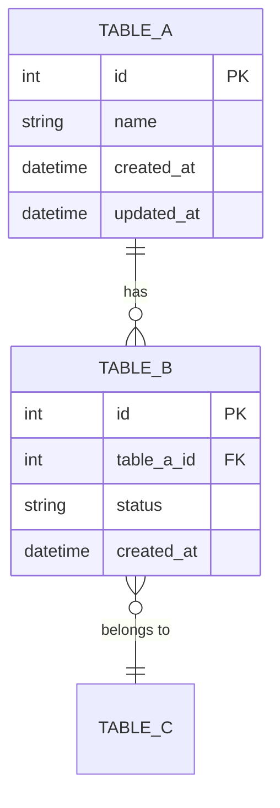

# DB設計書（詳細設計）: {プロジェクト・機能名}

> Vモデル: 詳細設計 / 対応する検証: 単体テスト
> 機能（②）・画面（③）に必要なデータを、動くSQLのテーブル設計に落とし込む。

> **前提**: {DBエンジンとバージョン。未確定なら「特定のクラウド構成・DBエンジンに依存しない
> 汎用的な型で設計する」と書く} / {既存スキーマがあるなら、踏襲する範囲と変更する範囲}

## 1. テーブル一覧

| テーブル名 | 目的 | 関連機能(②) |
| ---------- | ---- | ----------- |
| {table_a} | {何のために持つか。1〜2文} | FUNC-01〜09（全機能の前提） |
| {table_b} | {} | FUNC-02, FUNC-04 |

## 2. ER図

## 3. テーブル定義

### {table_a}

**目的**: {このテーブルが何のために存在するか。どの機能・受入基準を支えるか。1〜2文}

| カラム | 型 | 制約 | 説明 |
| ------ | -- | ---- | ---- |
| id | integer | PK, AUTO_INCREMENT | 主キー |
| {column} | string | NOT NULL, UNIQUE | {何が入るか。なぜ必要か} |
| {column} | string | NULL | {NULLを許す理由を書く} |
| status | string | NOT NULL, DEFAULT '{既定値}' | ステータス（`{値1}`={意味} / `{値2}`={意味}） |
| {column}_id | integer | FK({参照先}.id), NOT NULL | {参照の意味} |
| created_at | datetime | DEFAULT CURRENT_TIMESTAMP | 作成日時 |
| updated_at | datetime | ON UPDATE CURRENT_TIMESTAMP | 更新日時 |

> UNIQUE制約: ({column_a}, {column_b}) — {重複を防ぐ理由}

### {table_b}

**目的**: {}

| カラム | 型 | 制約 | 説明 |
| ------ | -- | ---- | ---- |
| id | integer | PK, AUTO_INCREMENT | 主キー |
| {column} | text | NOT NULL | {} |
| {column}_id | integer | FK({参照先}.id), NULL, ON DELETE SET NULL | {削除時の挙動と、その理由} |
| created_at | datetime | DEFAULT CURRENT_TIMESTAMP | 作成日時 |

## 4. インデックス方針

UNIQUE制約が付与されたカラム（{列挙}）は制約により自動的にインデックスが張られる。
それ以外に、一覧・検索系で頻繁にWHERE条件に使われる以下のカラムには明示的にインデックスを付与する。

| テーブル | カラム | 理由 |
| -------- | ------ | ---- |
| {table} | {column} | {どのクエリのためか。「一覧取得で毎回絞り込む」など} |
| {table} | {column} | {} |

> PostgreSQLはFKに自動でインデックスを付与しないため、上記は明示的に付与すること。
> MySQL(InnoDB)はFK列を自動的にインデックスするが、一貫性のため設計書上も明記する。

## 5. 正規化・整合性の方針

- **正規化**: {どこまで正規化したか。あえて崩した箇所とその理由}
- **トランザクション境界**: {同時に書き込む必要がある範囲}
- **削除**: {物理削除か論理削除か。参照されているレコードを消したときどうなるか}

---

> 実際に動く CREATE 文（DDL）は Build フェーズの成果物として `db/schema.sql` などに作成する。
> この設計書ではテーブル定義表・ER図・制約までを正とする。

## 次のステップ

→ `05-api-ipo`（API・IPO一覧・詳細設計）でフローごとのIPOとAPI一覧を作成する
→ 必要に応じて `02-requirement`（要件定義書）の「対応テーブル」欄を追記更新する
