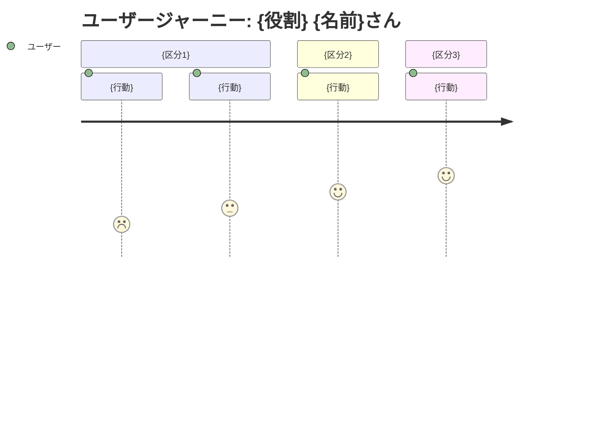

<!-- 章立てと表の列を見るための骨組み。分量は問わない。 -->
<!-- ID（P-n / G-n / J-n）は各表の1列目に置く。spec-check がこの位置を読むので、列の順番を変えない。 -->
# プロダクトビジョン: {プロダクト名}

> 要求（Why）の常設文書。プロダクト全体について「誰の・どんな課題を・なぜ解決するか」を定義する。
> 要件は requirements/、変更ごとの差分は specs/ に書く。この文書には機能・データ・画面を書かない。

updated: {YYYY-MM-DD}

## 1. 背景・課題

### 背景

{誰が、どんな状況で、何のためにこれを必要としているか。これを作ることになった経緯まで含める。}

### 現状

- {いまその仕事をどう回しているか}
- {そのやり方で何が起きているか}

### 課題一覧

| ID | 課題 | 困っている人 | 影響度 | 優先度 |
|----|------|------------|--------|--------|
| P-1 | {課題} | {役割} | 高 | 高 |

<!-- 廃止した項目は ID を ~~P-2~~ にして行を残し、理由を変更履歴に書く。番号は詰めない。 -->

## 2. ゴール

| ID | 種別 | ゴール | 解決する課題 |
|----|------|-------|------------|
| G-1 | ビジネス | {作る側・提供する側から見て何が達成されるか} | P-1 |
| G-2 | ユーザー | {使う人から見て何が良くなるか} | P-1, P-2 |

### 成功指標

| 指標 | 目標値 | 測定方法 | 対応するゴール |
|------|--------|---------|--------------|
| {指標} | {目標値。定性でも可} | {分かる範囲で1行。測りようがなければ —} | G-1 |

<!-- 成功指標は方向まで。合否の線は要件の受入基準が引く。 -->

## 3. 非目標

| やらないこと | 理由 |
|------------|------|
| {プロダクトとしてやらないこと} | {なぜやらないか} |

## 4. ペルソナ

### {役割}（メインユーザー）

| 項目 | 内容 |
|------|------|
| 名前 | {名前}さん |
| 年齢 | {年代} |
| 職業 | {職業} |
| 部門 | {所属} |
| 技術スキル | {どの程度使い慣れているか} |

**目標・ゴール**

- {したいこと}

**課題（ペインポイント）**

- {困っていること}（P-1）

**利用状況**

| 利用場面 | 頻度 | 詳細 |
|---------|------|------|
| {場面} | {頻度} | {そこで何をするか} |

> 副次的なユーザーは想定しない（メインユーザーのみ）。
> ※別の要求を持つアクターがいる場合は、この下に2人目のペルソナを同じ形式で足す。

## 5. ユーザージャーニー

<!-- スコアはその場面での満足度（1 = つらい・不満、5 = 満足）。所要時間や重要度ではない。 -->

### メインフロー

| ID | フェーズ | 行動 | 課題・感情 | 解決 |
|----|---------|------|----------|------|
| J-1 | {フェーズ} | {行動} | 「{心の声}」（{感情}） | {何が解消するか。機能名ではなく体験で書く} |
| J-2 | {フェーズ} | {行動} | 「{心の声}」（{感情}） | {} |

<!-- 大まかな行動の流れが追えればよく、画面単位の操作までは割らない。 -->

### 感情の変化

- **開始時**: {}
- **最初のつまずき**: {}
- **ブレークスルー**: {}
- **ゴール達成時**: {}

## 6. 利害関係者

| 利害関係者 | 期待 |
|-----------|------|
| {ペルソナ本人} | {} |
| {後工程・承認者} | {} |

## 変更履歴

| 日付 | 変更 | きっかけ（spec 番号など） |
|------|------|------------------------|
| {YYYY-MM-DD} | 初版 | — |
