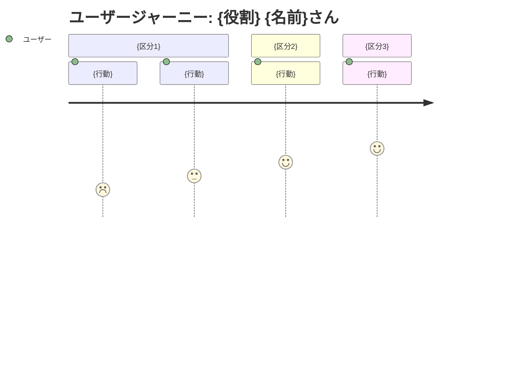

<!-- 章立てと表の列を見るための骨組み。分量は問わない。 -->

# 要求定義書: {プロジェクト・機能名}

> Vモデル: 要求分析 / 対応する検証: 受入テスト
> このプロジェクトで「誰の・どんな課題を・なぜ解決するか」を定義する。

## 1. 背景・課題

### 背景

{誰が、どんな状況で、何のためにこれを必要としているか。数段落で書く。
 これを作ることになった経緯まで含める。}

### 現状

- {いまその仕事をどう回しているか}
- {そのやり方で何が起きているか}

### 課題一覧

| # | 課題 | 影響度 | 優先度 |
|---|------|--------|--------|
| 1 | {課題} | 高 | 高 |
| 2 | {課題} | 中 | 高 |

## 2. ゴール

### ビジネスゴール

{作る側・提供する側から見て何が達成されるか}

### ユーザーゴール

{使う人から見て何が良くなるか}

### 成功指標

| 指標 | 目標値 | 測定方法 |
|------|--------|---------|
| {指標} | {目標値。定性でも可} | {分かる範囲で1行。測りようがなければ —} |

## 3. ペルソナ

### {役割}（メインユーザー）

| 項目 | 内容 |
|------|------|
| 名前 | {名前}さん |
| 年齢 | {年代} |
| 職業 | {職業} |
| 部門 | {所属} |
| 技術スキル | {どの程度使い慣れているか} |

**目標・ゴール**

- {したいこと}

**課題（ペインポイント）**

- {困っていること。1章の課題一覧と対応させる}

**利用状況**

| 利用場面 | 頻度 | 詳細 |
|---------|------|------|
| {場面} | {頻度} | {そこで何をするか} |

> 副次的なユーザーは想定しない（メインユーザーのみ）。
> ※別の要求を持つアクターがいる場合は、この下に2人目のペルソナを同じ形式で足す。

## 4. ユーザージャーニー

### メインフロー

| # | フェーズ | 行動 | 課題・感情 | 解決 |
|---|---------|------|----------|------|
| 1 | {フェーズ} | {行動} | 「{心の声}」（{感情}） | {何が解消するか。体験で書く} |
| 2 | {フェーズ} | {行動} | 「{心の声}」（{感情}） | {} |
| 3 | {フェーズ} | {行動} | 「{心の声}」（{感情}） | {} |

<!-- 大まかな行動の流れが追えればよく、画面単位の操作までは割らない。行数は必要なだけ。 -->

### 感情の変化

- **開始時**: {}
- **最初のつまずき**: {}
- **ブレークスルー**: {}
- **ゴール達成時**: {}

## 5. 利害関係者

| 利害関係者 | 期待 |
|-----------|------|
| {ペルソナ本人} | {} |
| {後工程・承認者} | {} |

---

## 次のステップ

→ `02-requirement`（要件定義書）で機能一覧・要件・スコープ・非機能要件を定義する
